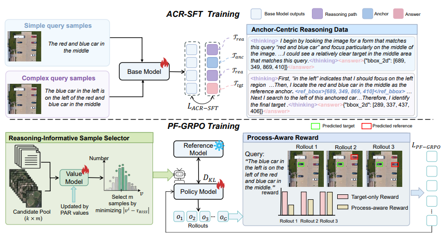

<div align="center">

<h1>
  
  GeoSearcher
</h1>

<h3>Anchor-Guided Progressive Reasoning for Remote Sensing Visual Grounding with Process Supervision</h3>

<strong>Accepted by <em>Information Fusion</em> (2026)</strong>

[](https://arxiv.org/abs/2607.01050)
[](https://huggingface.co/wangdianyu/GeoSearcher-4B)
[](https://www.sciencedirect.com/journal/information-fusion)

</div>

## 🔍 Overview

<p align="center"></p>

<!-- 中文：GeoSearcher 将遥感视觉定位重构为锚点引导的渐进式推理过程，而不是直接一步生成目标坐标。 -->
**GeoSearcher** is an anchor-guided progressive reasoning framework for **remote sensing visual grounding (RSVG)**. Instead of directly generating target coordinates in a single step, GeoSearcher uses explicit reference-object anchors to progressively integrate location, spatial-relation, and attribute clues before localizing the final target.

<!-- 中文：模型基于 Qwen3-VL-4B，通过锚点中心推理监督微调（ACR-SFT）和过程忠实的组相对策略优化（PF-GRPO）进行两阶段训练。 -->
Built upon **Qwen3-VL-4B**, GeoSearcher is trained in two stages:

1. **Anchor-Centric Reasoning Supervised Fine-Tuning (ACR-SFT):** constructs and learns from anchor-centric reasoning trajectories. Intermediate reference-object coordinates are explicitly represented using `<ref_bbox>...</ref_bbox>`.
2. **Process-Faithful Group Relative Policy Optimization (PF-GRPO):** improves grounding and intermediate reasoning behavior using a **Process-Aware Reward (PAR)** and a **Reasoning-Informative Sample Selector (RISS)**.

## 🤗 Model Weights

<!-- 中文：模型权重、Processor 和 Tokenizer 的最新发布状态以 Hugging Face 页面为准。 -->
The official model repository is available on Hugging Face. Please check the repository for the latest checkpoint and processor/tokenizer files.

| Model | Backbone | Training | Download |
|:--|:--|:--|:--|
| **GeoSearcher-4B** | Qwen3-VL-4B | ACR-SFT + PF-GRPO | [🤗 Hugging Face](https://huggingface.co/wangdianyu/GeoSearcher-4B) |

## ⚙️ Environment Setup

<!-- 中文：单图推理直接使用 Transformers，无需安装 LLaMA-Factory 或 vLLM。PyTorch 应使用与本机 CUDA 兼容的版本。 -->
### Option 1: Transformers (single-image inference)

For single-image inference, **Transformers is sufficient as the inference framework**; LLaMA-Factory and vLLM are not required. Install a CUDA-compatible PyTorch build and the following dependencies:

```bash
pip install -U "transformers>=4.57.3" accelerate pillow
# Install a CUDA-compatible PyTorch build if torch is not already installed.
```

<!-- 中文：批量推理使用 LLaMA-Factory 的 vLLM 脚本。建议按对应项目说明安装依赖，并注意 CUDA/PyTorch/vLLM 的兼容性。 -->
### Option 2: LLaMA-Factory + vLLM (batch inference)

For batch inference, we recommend the official [LLaMA-Factory](https://github.com/hiyouga/LLaMA-Factory) vLLM inference script.

```bash
git clone https://github.com/hiyouga/LLaMA-Factory.git
cd LLaMA-Factory
pip install -e ".[torch,metrics]"
pip install -U vllm
```

## 🖼️ Single-Image Inference (Transformers)

<!-- 中文：使用仓库中的 example/00014.jpg，默认提示词已经写在推理脚本中，无需额外指定 --query。 -->
A sample aerial image is provided at [`example/00014.jpg`](example/00014.jpg). The default query is:

> Find the specific object described as "The storage tank is on the left of the storage tank on the far right" in this aerial photo.

Run the single-image inference script from the GeoSearcher repository root:

```bash
python scripts/infer_single.py \
  --model wangdianyu/GeoSearcher-4B \
  --image example/00014.jpg \
  --output outputs/00014_prediction.jpg
```

<!-- 中文：脚本输出完整的模型生成内容，解析最终目标框 bbox_2d，并自动提取推理过程中的 <ref_bbox> 参考物坐标。所有有效参考物绘制为红色虚线框，最终目标绘制为绿色实线框；模型没有生成参考物坐标时，仅绘制目标框。 -->
The script prints the complete model response and extracts the final target coordinates from `bbox_2d`. If the reasoning contains one or more `<ref_bbox>...</ref_bbox>` spans, their reference-object bounding boxes are also extracted and visualized. **Reference anchors are shown as red dashed boxes, while the final target is shown as a green solid box.** If no reference anchor is generated, only the target box is displayed.

<!-- 中文：模型输出的坐标采用 0–1000 归一化尺度，脚本会转换为原始图像像素坐标，并将绘制结果保存至 --output 指定的位置。 -->
All predicted boxes are interpreted as coordinates normalized to the **0–1000 range** and converted to the original image resolution. The visualization is saved to the specified `--output` path.

<!-- 中文：图像通过结构化多模态消息传给 Processor，不要在单图脚本的文本问题前手动添加字面形式的 <image> 标记。可以使用 --query 修改问题。 -->
**Note:** The image is supplied as structured multimodal input. Do not manually prepend the literal `<image>` token when using this Transformers script. You may override the default query with `--query`.

## 🚀 Batch Inference (LLaMA-Factory + vLLM)

<!-- 中文：批量推理直接使用已有的 DIOR_RSVG_test.json；不需要另建一份推理数据，也不需要数据格式转换脚本。 -->
For dataset-level inference, use LLaMA-Factory's [`scripts/vllm_infer.py`](https://github.com/hiyouga/LLaMA-Factory/blob/main/scripts/vllm_infer.py). The existing DIOR-RSVG test set can be used directly without creating or converting another inference dataset.

### 1. Dataset Format (ShareGPT)

<!-- 中文：下面展示 DIOR_RSVG_test.json 的两条实际格式示例。messages 中 user 为问题，assistant 为对应真值标注；images 指向本地影像路径。此示例仅用于说明格式，不需要为批量推理另建一个 JSON。 -->
`DIOR_RSVG_test.json` uses the **ShareGPT** format, with `messages` for the image-grounding conversation and `images` for the image paths. The following example shows two records (also available as [`example/DIOR_RSVG_test_example.json`](example/DIOR_RSVG_test_example.json)):

```json
[
  {
    "messages": [
      {
        "content": "<image>Find the specific object described as \"A green and brown golf field\" in this aerial photo.",
        "role": "user"
      },
      {
        "content": "{\n\"bbox_2d\": [166, 296, 855, 840]\n}",
        "role": "assistant"
      }
    ],
    "images": [
      "/mnt/sdb/datasets/wangdianyu/JPEGImages/00001.jpg"
    ]
  },
```

<!-- 中文：这里的 assistant 消息是测试集的真实标注，用于后续对照，不是需要提前提供给模型的预测结果。影像绝对路径需替换成用户本地路径。 -->
The `assistant` message provides the ground-truth bounding box for evaluation; it is **not the model's prediction**. Replace the example image paths with valid paths in your environment.

### 2. Register the Dataset

<!-- 中文：在 LLaMA-Factory/data/dataset_info.json 中加入以下条目。如果原来已经注册过，就不需要重复添加。 -->
Add the following entry to `LLaMA-Factory/data/dataset_info.json`. Skip this step if `DIOR_RSVG_test` is already registered:

```json
"DIOR_RSVG_test": {
  "file_name": "/mnt/sdb/datasets/wangdianyu/DIOR_RSVG_test.json",
  "formatting": "sharegpt",
  "columns": {
    "messages": "messages",
    "images": "images"
  },
  "tags": {
    "role_tag": "role",
    "content_tag": "content",
    "user_tag": "user",
    "assistant_tag": "assistant"
  }
}
```

<!-- 中文：该代码块是 dataset_info.json 顶层对象中的一个条目，不是独立完整的 JSON 文件。路径与逗号需按本地文件实际情况调整。 -->
This is an entry within the existing `dataset_info.json`, not a standalone JSON file. Update `file_name` to point to your local dataset and keep the surrounding JSON syntax valid.

### 3. Run Batch Inference

<!-- 中文：下面的模板、图像像素上限、batch_size 和采样参数均按当前使用的设置保留，不再替换为旧版配置。请在 LLaMA-Factory 根目录执行。 -->
From the **LLaMA-Factory repository root**, run:

```bash
mkdir -p outputs

CUDA_VISIBLE_DEVICES=0 python scripts/vllm_infer.py \
  --model_name_or_path wangdianyu/GeoSearcher-4B \
  --template qwen3_vl \
  --dataset DIOR_RSVG_test \
  --cutoff_len 4096 \
  --max_new_tokens 1024 \
  --image_max_pixels 1048576 \
  --batch_size 1024 \
  --temperature 0.95 \
  --top_p 0.7 \
  --top_k 50 \
  --save_name outputs/DIOR_RSVG_test_predictions.jsonl
```

<!-- 中文：数据集名称必须与 dataset_info.json 中的注册名称一致。批量推理直接读取已注册的原始 JSON。 -->
The `--dataset DIOR_RSVG_test` argument refers to the entry registered above. The script loads the original dataset directly.

<!-- 中文：vLLM 脚本将生成结果保存为 JSONL，但不自动计算 Pr@0.5、Pr@0.7 或 mIoU。batch_size=1024 可能带来较高的内存开销，设备不足时可以减小。 -->
Predictions are written to `outputs/DIOR_RSVG_test_predictions.jsonl`. This command performs inference only; it does not automatically calculate Pr@0.5, Pr@0.7, or mIoU. For memory-constrained hardware, reduce `--batch_size` as needed.

## 📁 Benchmarks

<!-- 中文：以下为最终论文报告的三个测试集结果。 -->
GeoSearcher is evaluated on three RSVG benchmarks:

| Benchmark | Pr@0.5 (%) | Pr@0.7 (%) | mIoU (%) |
|:--|--:|--:|--:|
| DIOR-RSVG | **83.2** | **72.4** | **73.5** |
| OPT-RSVG | **81.2** | **65.5** | **69.4** |
| VRS-Bench | **80.3** | **64.4** | **69.2** |

## 🙏 Acknowledgments

GeoSearcher builds upon the [Qwen3-VL](https://huggingface.co/Qwen/Qwen3-VL-4B-Instruct) model family. We sincerely thank the developers of [LLaMA-Factory](https://github.com/hiyouga/LLaMA-Factory) and [verl](https://github.com/volcengine/verl) for providing excellent open-source frameworks that support supervised fine-tuning and reinforcement learning. We also thank the developers of the DIOR-RSVG, OPT-RSVG, and VRS-Bench datasets, as well as the broader open-source research community.
